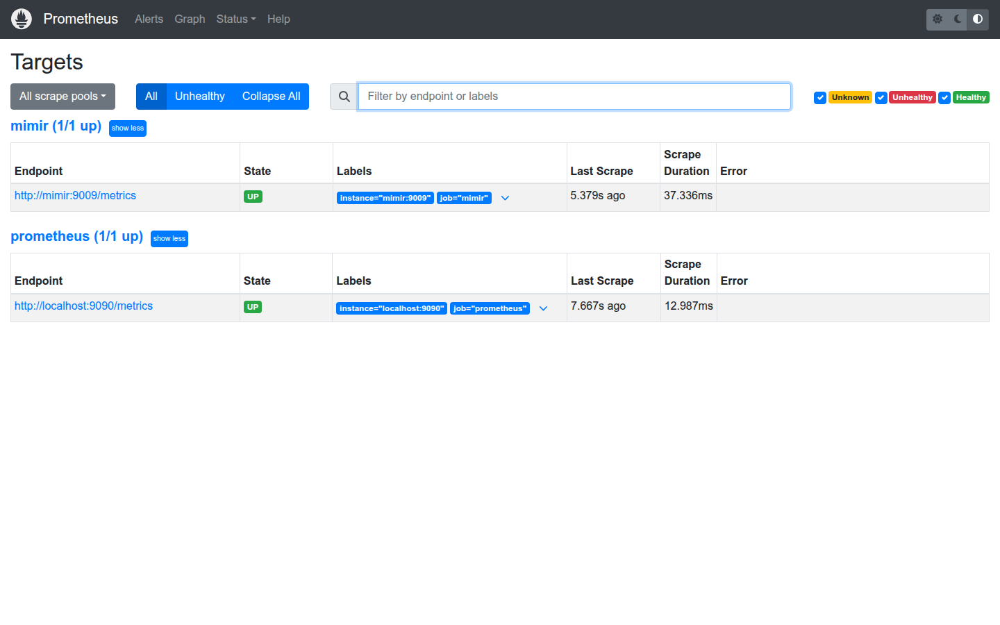
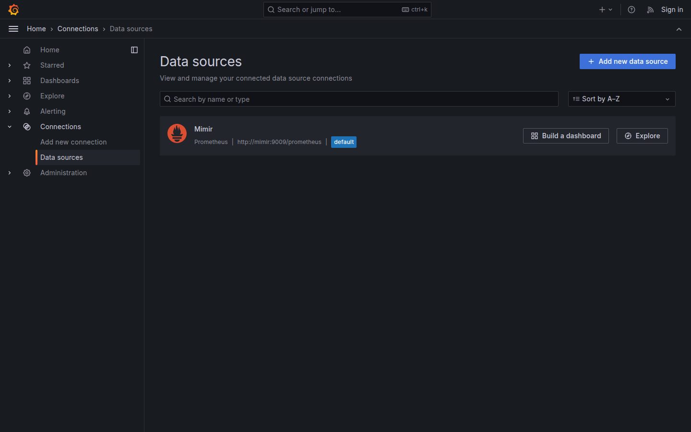
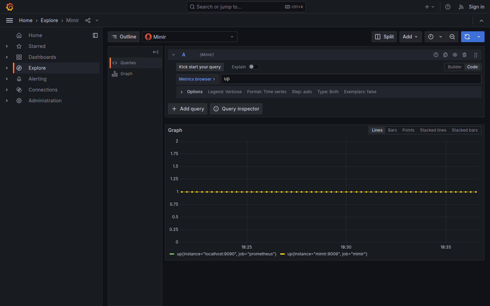
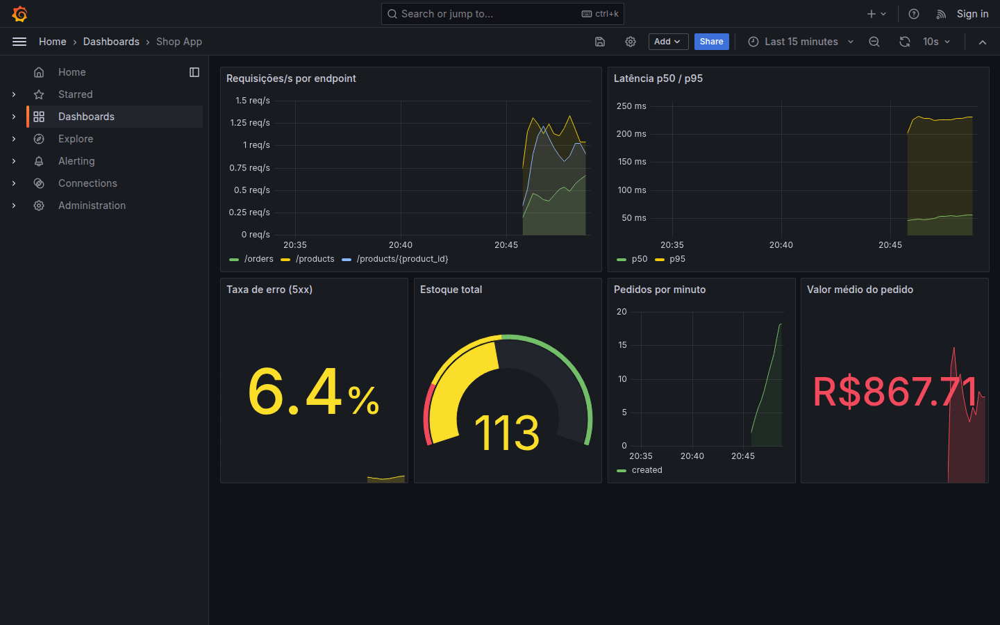

# lab_mimir

Laboratório local de observabilidade com Prometheus, Grafana Mimir e Grafana.

## Arquitetura

```
Shop App (FastAPI) --scrape--> Prometheus --remote_write--> Mimir --datasource--> Grafana
      ^
   loadgen
```

- **Shop App**: API FastAPI simulando um e-commerce, instrumentada com `prometheus-client` (requisições, latência, pedidos, estoque).
- **loadgen**: gerador de carga contínua contra a Shop App.
- **Prometheus**: coleta métricas (da app, de si mesmo e do Mimir) e as envia via `remote_write` para o Mimir.
- **Mimir**: armazena as métricas de longo prazo, em modo single-binary com storage em filesystem local.
- **Grafana**: consulta o Mimir (compatível com a API do Prometheus) como datasource já provisionado, com dashboard da app incluso.

## Estrutura

```
docker-compose.yml
app/main.py                                # API FastAPI instrumentada (Shop App)
app/loadgen.py                             # gerador de carga
mimir/mimir.yaml                           # config do Mimir (single-binary, filesystem)
prometheus/prometheus.yml                  # scrape configs + remote_write para o Mimir
grafana/provisioning/datasources/mimir.yaml # datasource do Grafana apontando pro Mimir
grafana/provisioning/dashboards/dashboards.yaml # provider de dashboards
grafana/dashboards/shop.json               # dashboard da Shop App
```

## Como usar

Subir o ambiente (o `--build` compila a imagem da Shop App na primeira vez e após mudanças no código):

```bash
docker compose up -d --build
```

Conferir se os 5 containers estão rodando:

```bash
docker compose ps
```

Serviços expostos:

| Serviço    | URL                     |
|------------|-------------------------|
| Grafana    | http://localhost:3000   |
| Prometheus | http://localhost:9090   |
| Mimir      | http://localhost:9009   |
| Shop App   | http://localhost:8000   |

O Grafana está configurado com login anônimo habilitado (role Admin), sem necessidade de autenticação.

### Logs

```bash
# todos os serviços, acompanhando em tempo real
docker compose logs -f

# um serviço específico
docker compose logs -f app       # Shop App
docker compose logs -f loadgen   # gerador de carga
docker compose logs -f mimir     # Mimir
docker compose logs -f prometheus
docker compose logs -f grafana
```

### Aplicando mudanças de configuração

- **Código da app** (`app/*.py`): `docker compose up -d --build app loadgen`
- **`prometheus/prometheus.yml`**: o arquivo é bind mount, mas o Prometheus só lê a config no start — rode `docker restart prometheus`
- **`mimir/mimir.yaml`**: `docker restart mimir`
- **Dashboards** (`grafana/dashboards/*.json`): recarregados automaticamente a cada 30s, sem restart

Para derrubar o ambiente:

```bash
docker compose down
```

Para remover também os dados persistidos pelo Mimir:

```bash
docker compose down -v
```

## Validação

### 1. Prometheus coletando métricas

Em http://localhost:9090/targets, os dois jobs (`prometheus` e `mimir`) devem aparecer com estado **UP**:



### 2. Datasource do Mimir provisionado no Grafana

Em http://localhost:3000/connections/datasources, o datasource **Mimir** aparece já provisionado como default, apontando para `http://mimir:9009/prometheus`:



### 3. Métricas chegando no Mimir via remote_write

No Explore do Grafana, consultando `up` pelo datasource Mimir, as duas séries aparecem com valor `1` — ou seja, as métricas coletadas pelo Prometheus estão sendo gravadas no Mimir e consultadas de lá:



Também dá pra validar direto pela API do Mimir:

```bash
curl -s 'http://localhost:9009/prometheus/api/v1/query?query=count(up)'
# {"status":"success","data":{"resultType":"vector","result":[{"metric":{},"value":[...,"3"]}]}}
```

## Shop App

A Shop App é uma API FastAPI que simula um e-commerce, com latência variável e ~5% de erros para gerar métricas interessantes:

| Endpoint                  | Descrição                       |
|---------------------------|---------------------------------|
| `GET /products`           | Lista produtos                  |
| `GET /products/{id}`      | Detalhe de um produto           |
| `POST /orders`            | Cria pedido (debita estoque)    |
| `GET /metrics`            | Métricas no formato Prometheus  |
| `GET /health`             | Healthcheck                     |

Métricas expostas:

- `shop_http_requests_total{method, endpoint, status}` — contador de requisições
- `shop_http_request_duration_seconds{endpoint}` — histograma de latência
- `shop_orders_total{status}` — pedidos criados/falhos
- `shop_order_value_brl` — histograma do valor dos pedidos
- `shop_products_in_stock` — gauge de estoque (reposto automaticamente)

O serviço `loadgen` gera tráfego contínuo (incluindo 404s propositais), e o dashboard **Shop App** é provisionado automaticamente no Grafana, lendo tudo do Mimir:



## Visualizando as métricas

Há quatro formas de ver as métricas da aplicação, da mais crua à mais pronta:

**1. Direto na app** — o que o Prometheus coleta:

```bash
curl -s http://localhost:8000/metrics | grep ^shop_
```

**2. Pela API do Mimir** — provando que chegaram via `remote_write`:

```bash
# requisições/s por endpoint
curl -s 'http://localhost:9009/prometheus/api/v1/query?query=sum by (endpoint) (rate(shop_http_requests_total[1m]))'

# latência p95
curl -s 'http://localhost:9009/prometheus/api/v1/query?query=histogram_quantile(0.95, sum by (le) (rate(shop_http_request_duration_seconds_bucket[5m])))'
```

**3. No Explore do Grafana** — http://localhost:3000/explore com o datasource **Mimir**. Queries úteis:

| Query | O que mostra |
|-------|--------------|
| `sum by (endpoint) (rate(shop_http_requests_total[1m]))` | Requisições/s por endpoint |
| `100 * sum(rate(shop_http_requests_total{status=~"5.."}[5m])) / sum(rate(shop_http_requests_total[5m]))` | Taxa de erro (%) |
| `histogram_quantile(0.95, sum by (le) (rate(shop_http_request_duration_seconds_bucket[5m])))` | Latência p95 |
| `sum by (status) (rate(shop_orders_total[5m])) * 60` | Pedidos por minuto |
| `shop_products_in_stock` | Estoque atual |

**4. No dashboard pronto** — http://localhost:3000/d/shop-app (Dashboards → Shop App), com refresh automático de 10s.

Para gerar carga manual além do loadgen:

```bash
curl -s http://localhost:8000/products
curl -s http://localhost:8000/products/3
curl -s -X POST http://localhost:8000/orders -H 'Content-Type: application/json' -d '{"product_id": 1, "quantity": 2}'
```
